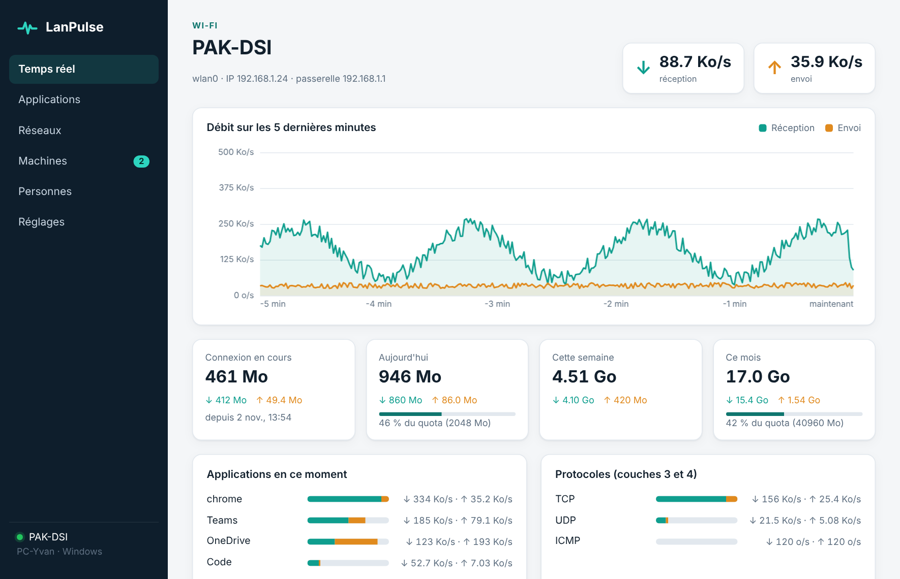
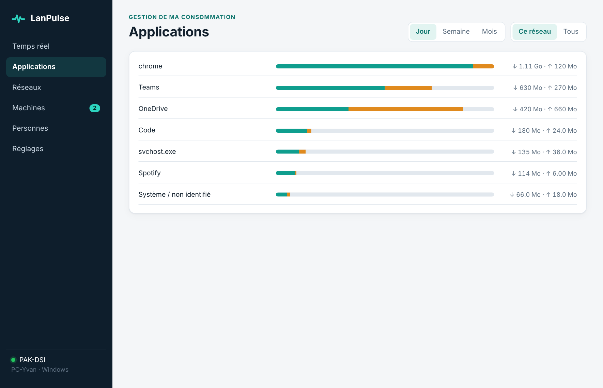
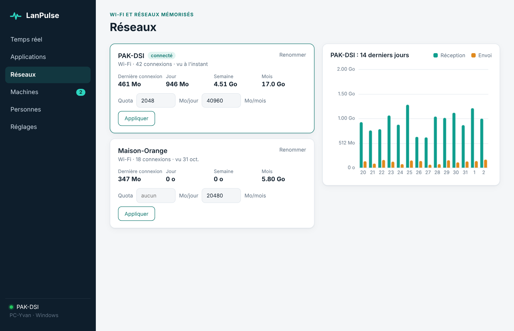
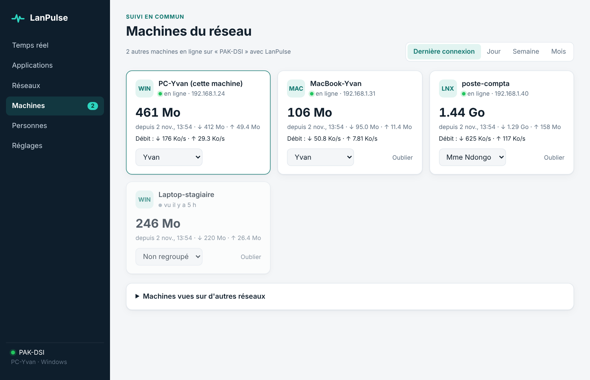
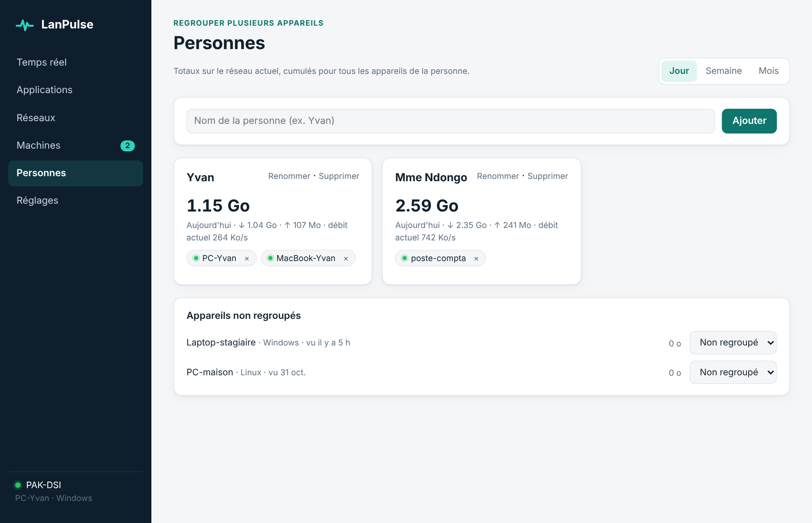
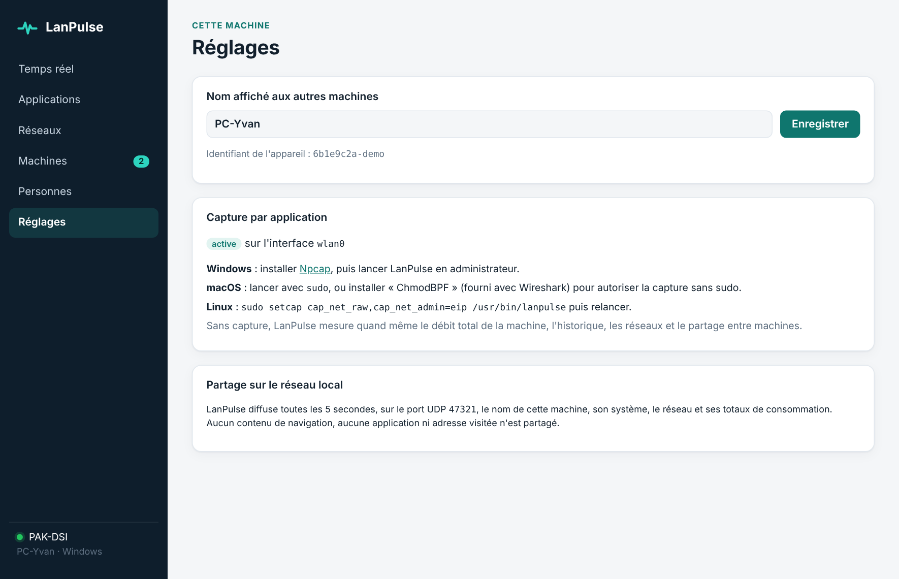

# LanPulse

Suivi de la consommation réseau, par machine et en commun sur le réseau local.
Application de bureau Tauri 2 (Rust + HTML/JS) pour **Windows, macOS et Linux**,
avec icône dans la zone de notification (Windows, Linux) et dans la barre de
menus (macOS, débit affiché en direct).

## Ce que fait l'application

| Fonction | Détail |
|---|---|
| Débit en temps réel | Réception et envoi de l'interface active, graphique des 5 dernières minutes, débit visible dans la barre système |
| Par application | Capture des paquets (couches 3 et 4 : IPv4/IPv6, TCP/UDP), rapprochement port local → processus |
| Protocoles | Répartition TCP / UDP / ICMP en direct |
| Réseaux mémorisés | Chaque Wi-Fi ou réseau rejoint est enregistré : nombre de connexions, totaux par période, historique 14 jours, renommage |
| Gestion de sa consommation | Quotas par réseau (Mo/jour, Mo/mois) avec notification à 80 % et 100 % |
| Suivi en commun | Les machines qui ont LanPulse sur le même réseau se découvrent automatiquement et voient la consommation totale des autres : dernière connexion à ce réseau, jour, semaine, mois |
| Personnes | Regroupement manuel de plusieurs appareils sous une même personne, avec totaux cumulés |

Seuls des **totaux** sont partagés entre machines (nom de l'appareil, système,
réseau, débit, totaux par période). Le détail par application et les adresses
visitées restent sur la machine.

## Aperçu

| Temps réel | Applications |
|---|---|
|  |  |
| **Réseaux mémorisés** | **Machines du réseau (suivi en commun)** |
|  |  |
| **Personnes** | **Réglages et quotas** |
|  |  |

*Captures en mode démonstration (données fictives).*

## Téléchargement

Rendez-vous dans les [**Releases**](../../releases/latest) :

| Système | Installeur | Version portable (sans installation) |
|---|---|---|
| Windows | `.msi` ou `-setup.exe` | `LanPulse_portable_windows_x64.zip` (extraire, lancer `LanPulse.exe`) |
| macOS | `.dmg` (Apple Silicon et Intel) | `LanPulse_portable_macos-*.app.zip` |
| Linux | `.deb`, `.rpm` | `LanPulse_portable_linux_x86_64.AppImage` (`chmod +x` puis lancer) |


## Architecture

```
src/                     Interface (HTML, CSS, JS sans framework)
src-tauri/src/
  lib.rs                 Démarrage, commandes appelées par l'interface
  monitor.rs             Boucle 1 s : débit, changement de réseau, écriture, quotas, annonces
  capture.rs             Capture pcap + attribution du trafic aux processus
  wifi.rs                Réseau courant : interface, passerelle, SSID
  peers.rs               Annonces UDP broadcast entre machines (port 47321)
  db.rs                  SQLite : réseaux, sessions, conso journalière et par appli, pairs, personnes
  tray.rs                Icône de barre système et menu
  state.rs               État partagé
```

**Identifiant du réseau.** Il est dérivé de l'adresse MAC de la passerelle (le routeur ou la box du réseau) :
deux machines branchées sur le même routeur obtiennent le même identifiant,
même si le SSID n'est pas lisible (macOS récent, réseau filaire).

**Mise à jour entre machines.** À chaque annonce reçue, les totaux de la machine émettrice sont écrits dans la base locale du récepteur : toutes les machines d'un même réseau convergent vers les mêmes chiffres.

**Découverte des pairs.** Toutes les 5 s, chaque instance envoie une annonce
JSON en broadcast UDP (port 47321). Une machine est « en ligne » si elle s'est
annoncée dans les 15 dernières secondes. Les machines déjà vues restent
listées avec leurs derniers totaux connus.

**Attribution par application.** Chaque paquet est décodé jusqu'aux ports
TCP/UDP. Le port local est rapproché de la table des sockets du système
(`netstat2`), et le nom du processus est résolu dès l'apparition du socket.
Les octets d'une connexion très brève, dont le socket n'est pas encore visible,
sont mis en attente puis attribués dès qu'il apparaît. Test réalisé :
99,9 % du trafic d'un téléchargement attribué au bon processus.

## Lancer en développement

Prérequis : [Rust](https://rustup.rs), Node.js 18+, et :

- **Linux (Debian/Ubuntu)** :
  `sudo apt install libwebkit2gtk-4.1-dev libayatana-appindicator3-dev librsvg2-dev libpcap-dev`
- **macOS** : Xcode Command Line Tools (`xcode-select --install`)
- **Windows** : Visual Studio Build Tools (C++), WebView2 (déjà présent sur Windows 10/11),
  [SDK Npcap](https://npcap.com/#download) décompressé, puis
  `set LIB=C:\chemin\npcap-sdk\Lib\x64`

```bash
npm install
npm run dev        # lance l'application
npm run build      # produit les installeurs dans src-tauri/target/release/bundle/
```

L'interface peut aussi être ouverte seule dans un navigateur (`src/index.html`) :
elle affiche alors des données de démonstration.

## Compiler pour les trois systèmes

Le workflow `.github/workflows/build.yml` compile Windows (.msi, .exe),
macOS Apple Silicon et Intel (.dmg) et Linux (.deb, .rpm, .AppImage).

Il produit les installeurs **et** les versions portables.

1. Onglet **Actions** > **Compilation LanPulse** > **Run workflow** :
   les fichiers sont dans les *artifacts* du run. Renseigner le champ `tag`
   (ex. `v0.1.0`) publie aussi une release.
2. Ou pousser un tag (`git tag v0.1.0 && git push --tags`) : la release est créée automatiquement.

## Activer la vue par application

Sans ces droits, tout le reste fonctionne (débit total, réseaux, quotas, partage).

- **Windows** : installer [Npcap](https://npcap.com) puis lancer LanPulse en administrateur.
  Au premier lancement, autoriser LanPulse dans le pare-feu (réseaux privés) pour le partage.
- **macOS** : `sudo /Applications/LanPulse.app/Contents/MacOS/lanpulse`, ou installer
  ChmodBPF (fourni avec Wireshark) pour capturer sans sudo.
- **Linux** : `sudo setcap cap_net_raw,cap_net_admin=eip /usr/bin/lanpulse`
  (à refaire après chaque mise à jour). Les processus des autres comptes apparaissent
  en « Système / non identifié » sans droits root.

## Données

Base SQLite locale :
- Linux : `~/.local/share/cm.lanpulse.app/lanpulse.sqlite`
- macOS : `~/Library/Application Support/cm.lanpulse.app/lanpulse.sqlite`
- Windows : `%APPDATA%\cm.lanpulse.app\lanpulse.sqlite`

## Limites connues (version 0.1)

- Les annonces entre machines ne sont pas authentifiées : une machine du réseau
  pourrait envoyer de faux totaux. À prévoir : clé partagée par groupe et signature HMAC.
- Les réseaux qui isolent les clients (Wi-Fi invités, certains réseaux d'entreprise)
  bloquent le broadcast : les machines ne se voient pas.
- macOS 14.4+ ne donne le nom du Wi-Fi qu'avec l'autorisation de localisation ;
  sans elle, le réseau s'affiche sous le nom de sa passerelle (l'identifiant reste correct).
- Pas de limitation de débit par application (contrairement à NetLimiter) : LanPulse
  mesure et alerte. La limitation demande un pilote réseau par système.
- Les installeurs ne sont pas signés : avertissement SmartScreen (Windows) et
  Gatekeeper (macOS : clic droit > Ouvrir la première fois).
